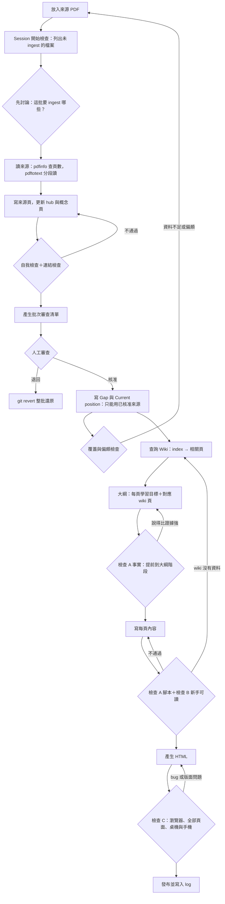

# 用 AI 改造你眼前的世界：MR 外觀改造入門 — LLM Wiki 與教學簡報

> 繳交標題：`學校 學號 系級 姓名 MR 外觀改造`（請自行填寫）

## 1. LLM Wiki 主題與簡介

主題是我的研究方向：**用生成式 AI，依使用者描述的個人風格，改造真實物體的外觀，並在混合實境（MR）中讓新外觀貼在物體上、跟著移動**。

Wiki 依照 Karpathy 的 LLM Wiki 做法建立：
- **三層結構**：`raw/` 放原始文獻（唯讀，PDF 不公開）；`wiki/` 由 LLM 撰寫與維護；[`AGENTS.md`](AGENTS.md) 是規範，寫明目標、限制、完成標準、煞車、觸發與審查。
- **規模**：目前 ingest 8 篇文獻，分兩批，每批都先討論、再 ingest、再經人工審查核准，共 3 個概念頁、6 個 pipeline 頁、3 個研究問題頁。
- **工具**：在 Obsidian 中瀏覽，Claude Code 負責寫入，每個操作都有一個 git commit。

## 2. LLM Wiki 連結

- Repo：https://github.com/candytangsys/mr-llm-wiki
- 目錄：[`wiki/index.md`](wiki/index.md)
- 研究全貌與目前論點：[`wiki/overview.md`](wiki/overview.md)
- 時間序紀錄：[`wiki/log.md`](wiki/log.md)
- Obsidian graph view 截圖：`docs/graph.png`（請自行加入）

## 3. 教學 HTML 簡報

- 線上瀏覽：https://candytangsys.github.io/mr-llm-wiki/slides/
- 原始檔：[`slides/index.html`](slides/index.html)，單一 HTML 檔，雙擊即可離線開啟
- 共 14 頁：學習目標 → 基本概念 → 三條路線 → 生成式 AI → 缺口 → pipeline → 待解問題 → 小測驗 → 回顧。每頁底部標出對應的 wiki 頁，大綱與來源對照見 [`wiki/questions/2026-11-22-slides-outline.md`](wiki/questions/2026-11-22-slides-outline.md)。
- 5 種 MR 示意動畫：Depth Interaction、Material Transformation、Surface Recognition、Spatial Tracking、Spatial Anchoring。

## 4. Loop / Graph 設計

**會重複執行的部分**
- ingest 迴圈：每一批新文獻都重跑「讀 → 寫 → 自我檢查 → 審查」。
- 覆蓋檢查發現資料不足或偏頗時，會回到「找新來源」。
- 簡報迴圈：檢查 A、B 不通過就回去改內容；wiki 沒有資料就回去查詢，必要時觸發新的 ingest。
- 檢查 C 不通過就改 HTML，然後**全部頁面重跑**。

**哪裡需要檢查或重新生成**
- **自我檢查**：每篇來源都要有頁碼、證據等級，推論要和事實分開。
- **審查閘門**：沒有經過人工核准的來源，不能寫進研究缺口和論點。
- **檢查 A（事實）**：簡報每句都要追得到 wiki 來源。
- **檢查 B（新手可讀）**：術語第一次出現要解釋，每頁一個重點。
- **檢查 C（呈現）**：翻頁、版面、手機寬度、console 錯誤。

**為什麼這樣設計**
- **wiki 是唯一的事實來源**：事實檢查因此可以機械化地對照，不靠模型記憶。
- **越早檢查越便宜**：大綱階段就先擋下「說得太滿」的句子，比做完 HTML 才發現便宜。
- **批次 ingest 有審查閘門**：錯誤不會在審查前擴散到論點。
- **煞車用看得到的指標**：例如頁數、改動數、查詢次數，用來控制 token 花費（見 [`AGENTS.md`](AGENTS.md) §8）。

## 5. 實際執行與檢查紀錄

| 紀錄 | 內容 |
|---|---|
| [`wiki/log.md`](wiki/log.md) | 每次 ingest、審查、查詢、煞車、規則修改的時間序紀錄 |
| [commit 歷史](https://github.com/candytangsys/mr-llm-wiki/commits/main) | 每個操作一個 commit，可以看到 wiki 與簡報一步一步長出來的過程 |
| [`wiki/review/2026-11-22-coverage.md`](wiki/review/2026-11-22-coverage.md) | 第一批資料的覆蓋與偏頗檢查，以及閱讀清單 |
| [`wiki/review/2026-11-22-batch-1.md`](wiki/review/2026-11-22-batch-1.md)、[`batch-2`](wiki/review/2026-11-22-batch-2.md) | 兩批 ingest 的審查清單與核准紀錄 |
| [`wiki/review/2026-11-22-slides-check.md`](wiki/review/2026-11-22-slides-check.md) | 簡報兩次執行的檢查 A／B／C 結果 |

## 6. 反思

實際發生過的問題（取自上面的紀錄）：

| 節點 | 發生了什麼 | 檢查往前移到哪 | workflow 的修改 |
|---|---|---|---|
| 讀取來源 | 只想讀摘要，卻把 26 頁 PDF 整份讀進來，違反 20 頁的煞車規則 | 讀之前先用 `pdfinfo` 查頁數 | 安裝 poppler，改成分段讀；AGENTS.md 升到 v0.4 |
| 選擇來源 | 前 4 篇都沒處理研究核心，資料偏頗 | ingest 之前先做覆蓋與偏頗檢查 | 新增閱讀清單；第二批照清單補齊核心文獻 |
| 寫論點 | 批次 ingest 可能把錯誤帶進研究缺口 | 寫論點之前先經人工審查 | 加入審查閘門：未核准的來源不能寫進 Gap |
| 簡報大綱 | 缺口說得太滿、混入非文獻數字、單一來源的統計 | 事實檢查從「寫完內容」提前到「大綱」 | 大綱每頁都要標來源，並寫明措辭規則 |
| 事實檢查腳本 | 數字對到錯的頁面也算通過 | 檢查要對照「該頁標註的來源」 | 下一輪改成只比對標註的來源檔 |
| HTML 呈現 | 翻頁 bug；加動畫後 3 頁版面超出 | 每次修改後全部頁面重跑 | 檢查 C 改成固定跑全部 14 頁 |

**我的反思**（請用自己的話寫）：
- 哪一個節點最常出錯？
- 發現問題後，把檢查往前移到了哪一個步驟？
- 有沒有因此修改 workflow／graph？為什麼？
